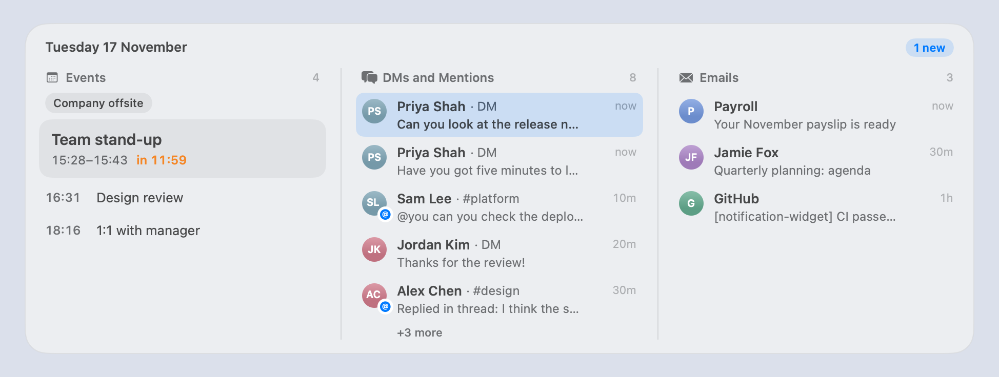
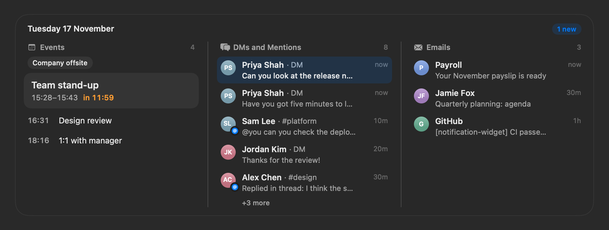
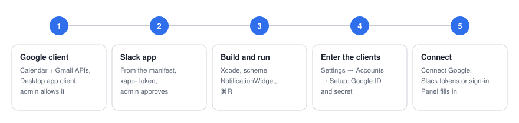
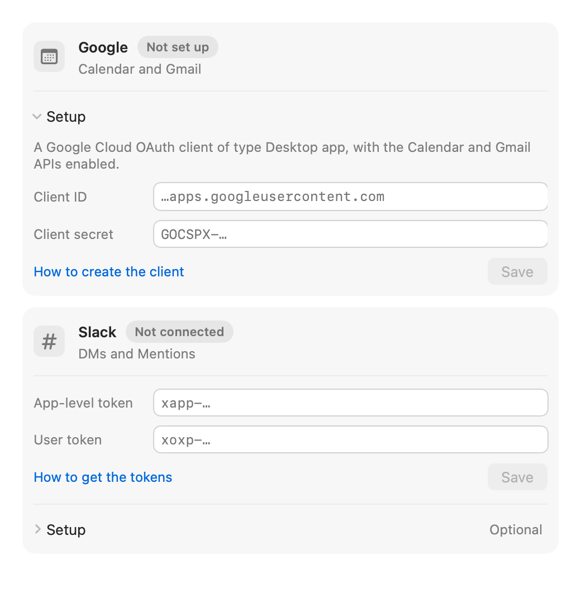

# Notification Widget

Everything that needs you today, in one strip on your desktop.

Notification Widget is a personal macOS menu bar app with a widget-style **Panel** on the desktop. It brings together:

- **Google Calendar**: today's Events, with the next one up front, a live countdown, and **Join** for Meet and Zoom
- **Slack**: DMs, group DMs, @mentions, replies in threads you've posted in, and keyword matches
- **Gmail**: unread mail in your Primary inbox, or any Gmail search you choose

New Items can trigger an **Alert**: a sound, and the Panel rising above your windows with a small shake. Sound and shake are set separately for Events, DMs, Mentions and Emails. Alerts go quiet during a macOS Focus, and the Panel is hidden from screen sharing.

Website: <https://notification-widget.adrianeyre.co.uk> · Repository: [github.com/adrianeyre/notification-widget](https://github.com/adrianeyre/notification-widget)

Dark mode

## Highlights

- **One look, three Sources.** Events, DMs and Mentions, and Emails side by side in a 940 × 320 strip that fits a short, wide display.
- **Alerts that are hard to miss, and easy to silence.** Per-category sounds (yours or the system's), shake, Ignore Focus, and Event Alerts at the Reminder Time that repeat until you look.
- **Private by default.** Hidden from screenshots and screen sharing, read-only at every Source, tokens in the Keychain.
- **Trustworthy.** A health status on each column with one-click Reconnect, automatic reconnect after sleep and network loss, and no burst of Alerts when it catches up.

More in [Features](docs/guide/features.md).

## Quick start

1. **Google:** create the OAuth client and get your Workspace admin to allow it. [Steps](docs/setup/google-oauth-client.md)
2. **Slack:** create the Slack app from the included manifest and get it approved. [Steps](docs/setup/slack-app.md)
3. **Build and run** `NotificationWidget.xcodeproj` in Xcode (scheme **NotificationWidget**, ⌘R). Optionally sign it with your Apple team, so Alerts can follow Focus. [Details](docs/guide/installation.md#step-3-optional-signing-for-focus)
4. **Enter the clients** in **Settings… → Accounts → Setup**: the Google client ID and secret, and optionally the Slack client.
5. **Connect** Google, and paste the Slack tokens or **Sign in with Slack**. [Details](docs/guide/installation.md#step-5-enter-the-clients-and-connect)

The full walkthrough, including putting the Panel on a strip display, is in [Installation and setup](docs/guide/installation.md).

## Documentation

| Guide | What's in it |
|---|---|
| [Features](docs/guide/features.md) | The Panel, Items, Alerts, Focus, privacy and Source health |
| [Installation and setup](docs/guide/installation.md) | Prerequisites, building, entering the clients, connecting Accounts |
| [Set up the Google OAuth client](docs/setup/google-oauth-client.md) | Google Cloud project, APIs, OAuth client, Workspace admin approval |
| [Set up the Slack app](docs/setup/slack-app.md) | Slack app from the manifest, tokens, admin approval, Sign in with Slack |
| [Settings](docs/guide/configuration.md) | Every setting in General, Accounts and Alerts, with screenshots |
| [Troubleshooting](docs/guide/troubleshooting.md) | Common problems and fixes |
| [Development](docs/guide/development.md) | Project layout, tests, sample data, screenshots, the website |
| [Releases and CI](docs/guide/releases-and-ci.md) | The workflow, semantic-release versions, GitHub Pages and the custom domain |
| [v1 soak test](docs/soak-test.md) | The one-week acceptance checklist |

Background: the [product requirements document](docs/product-requirements-document/0001-notification-widget.md), the architectural decision records ([0001: floating panel, not WidgetKit](docs/architectural-decision-record/0001-floating-panel-not-widgetkit.md), [0002: Slack through Socket Mode](docs/architectural-decision-record/0002-slack-socket-mode.md), [0003: Google sign-in without the SDK](docs/architectural-decision-record/0003-google-oauth-without-sdk.md)) and the [glossary](GLOSSARY.md) of terms (Item, Source, Alert, Panel and so on).

## Status

v1 is feature-complete and in its [soak test](docs/soak-test.md). Releases are automatic from `main`: see [Releases and CI](docs/guide/releases-and-ci.md).
