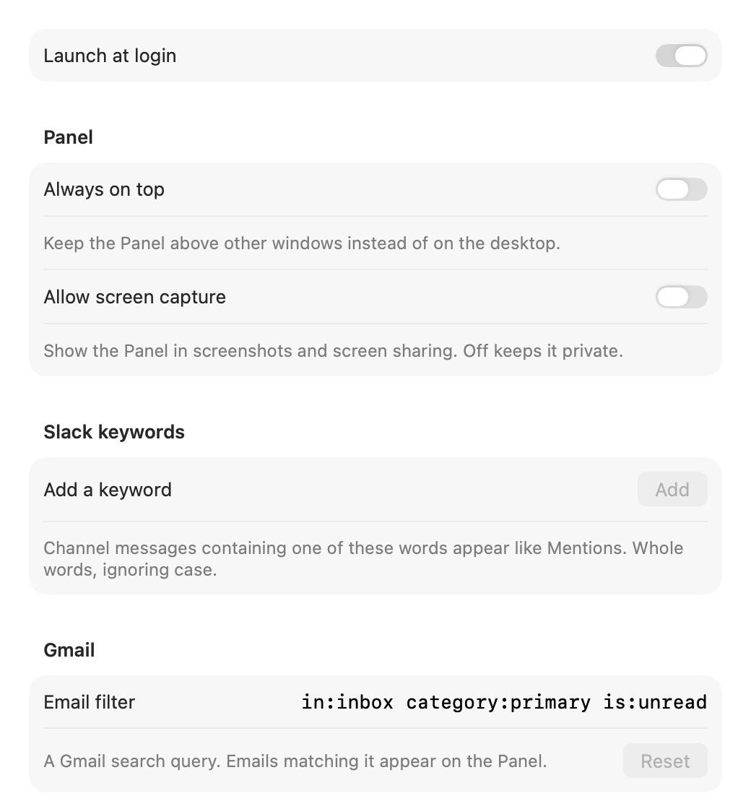
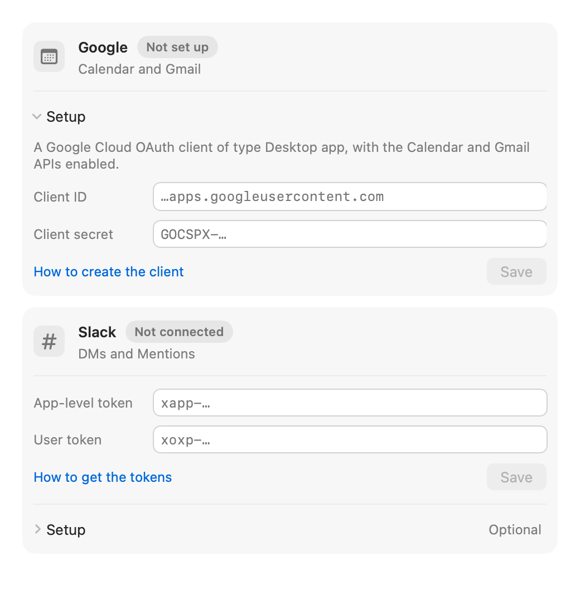
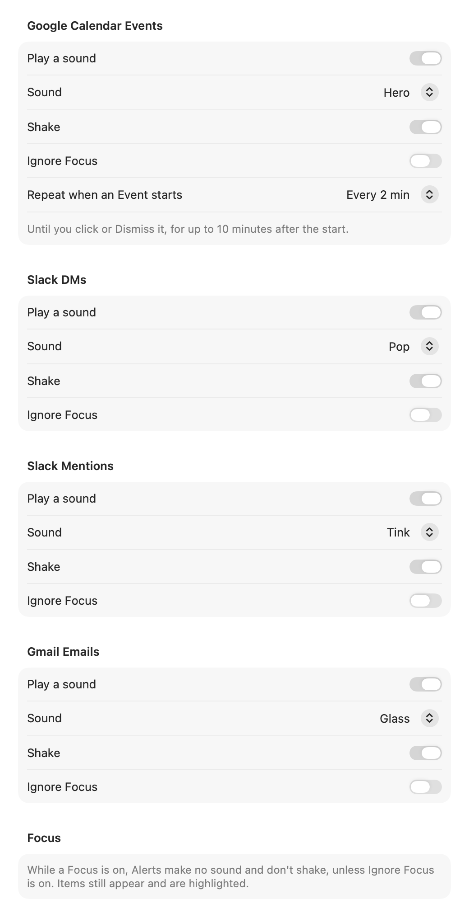

# Settings

[← Back to the README](../../README.md)

Open **Settings…** from the menu bar icon (or press ⌘, while the menu is open). Everything is saved on your Mac and survives restarts.

## General

| Setting | Default | What it does |
|---|---|---|
| Launch at login | On | Starts the app when you log in. macOS may ask you to allow it in Login Items. |
| Always on top | Off | Keeps the Panel above other windows instead of on the desktop. |
| Allow screen capture | Off | Shows the Panel in screenshots and screen sharing. Off keeps it private. |
| Slack keywords | None | Channel messages containing one of these words appear like Mentions. Whole words, ignoring case: "deploy" matches "Deploy failed" but not "redeployed". |
| Email filter | `in:inbox category:primary is:unread` | A Gmail search query: Emails matching it appear on the Panel. Any query that works in Gmail's search box works here. **Reset** puts the default back. |

**About** at the bottom shows the app's **Version** and build number, with a link to that version's **Release notes**. A copy built after a release shows how far after it is, for example `1.2.0 + 3 commits (abc1234)`, and `modified` if it was built with uncommitted changes. You can select the version to copy it into a bug report. The menu bar menu shows the version too.

## Accounts

Each Account is a card: its status (*Not set up*, *Not connected*, *Connected*, *Needs sign-in*), one action, and a **Setup** section, open until it's filled in.

- **Google** (Calendar and Gmail)
  - **Setup:** the Client ID and Client secret of your Google Cloud OAuth client (type *Desktop app*). Leave the secret blank to keep the saved one while changing the ID. **Clear** removes both. [How to create the client](../setup/google-oauth-client.md)
  - **Connect** signs in through the browser; **Disconnect** revokes the app's access and forgets the Account; **Sign in** appears when the sign-in has expired.
- **Slack** (DMs and Mentions)
  - Paste the **app-level token**, then **Sign in with Slack…** or paste the **user token** and **Save**. Tokens are checked with Slack before they're saved to the Keychain; a wrong or revoked token shows what's wrong. **Disconnect** deletes them.
  - **Setup** (optional): the Slack app's Client ID and Client secret, for Sign in with Slack. [How to set it up](../setup/slack-app.md#4-optional-set-up-sign-in-with-slack)

Client IDs are kept in the app's preferences, and secrets and tokens in the Keychain.

## Alerts

Each category (Google Calendar Events, Slack DMs, Slack Mentions, Gmail Emails) has:

| Setting | Default | What it does |
|---|---|---|
| Play a sound | On | Plays the chosen sound once per Alert. |
| Sound | Hero, Pop, Tink, Glass | A macOS system sound, or **Choose file…** for your own AIFF, WAV, MP3 or M4A. Choosing a sound plays it. Your files are copied to `~/Library/Application Support/Notification Widget/Sounds`. |
| Shake | On | Shakes the Panel when it rises (a pulse with Reduce Motion). |
| Ignore Focus | Off | Alerts normally even during a macOS Focus. |

Events also have **Repeat when an Event starts**: Off, or every 1, 2 (default), 3 or 5 minutes, until you click or Dismiss the Event, for up to 10 minutes after it starts.

At the bottom, **Focus** says whether the app can read your Focus status. If you denied access, allow it in System Settings → Privacy & Security → Focus.
