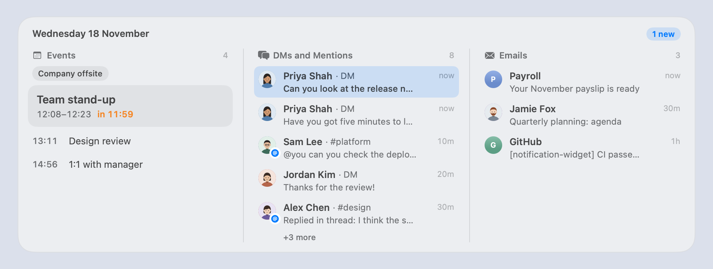
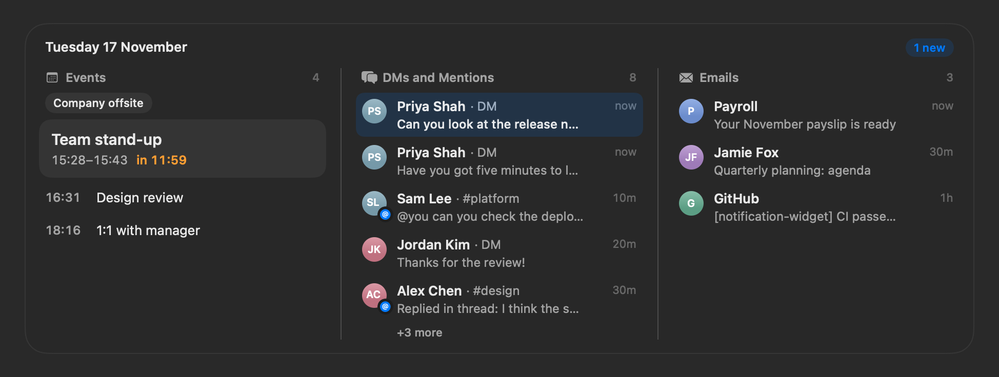
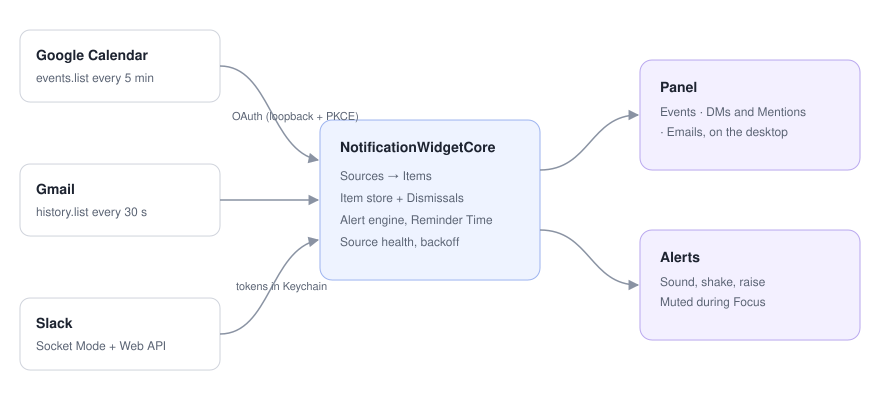

# Features

[← Back to the README](../../README.md)

Notification Widget is a menu bar app with one window: the **Panel**, a widget-style strip that sits on your desktop behind your other windows. It shows the **Items** that need your attention from three **Sources** (Google Calendar, Gmail and Slack) and draws your eye to new ones with an **Alert**. Words in bold are defined in the [glossary](../../GLOSSARY.md).

## The Panel

The Panel is a horizontal strip, 940 × 320 points, so it fits a short, wide display (such as a 1920 × 360 strip monitor) next to other widgets. It follows macOS light and dark mode.

| Part | What it shows |
|---|---|
| Header | Today's date, and how many Items are new (highlighted) |
| **Events** | All-day Events as chips; the next Event in a raised card with its time, a live countdown when it starts within 15 minutes, and **Join** for Google Meet or Zoom; then the rest of today |
| **DMs and Mentions** | Slack direct messages, group DMs, @mentions, replies in threads you've posted in, and keyword matches: who (with their Slack photo), where and the first ~100 characters |
| **Emails** | Unread mail matching your Gmail filter (by default the Primary inbox): sender (with their Gravatar, if they have one) and subject only, never the body |

Each column shows up to five Items, then "+N more". The count beside each column's title is the total.

- **Click an Item** to open it: Slack DMs and Mentions open in the Slack app, Emails in Gmail, Events in Google Calendar.
- **Hover an Item** and click **×** to **Dismiss** it. Dismiss only hides it on the Panel; nothing changes in Slack, Gmail or Calendar. Dismissals survive restarts.
- **Drag the date** to move the Panel. It remembers its position and screen, and goes back to the main screen if that screen is unplugged.
- The menu bar icon has **Show/Hide Panel**, **Settings…** and **Quit**.

## When Items leave

| Item | Leaves the Panel when |
|---|---|
| Event | It ends, or you Dismiss it |
| Email | It no longer matches your filter (for example you read it elsewhere), or you Dismiss it |
| DM or Mention | Slack reports the conversation as read (checked every 2 minutes), you reply in the conversation, 24 hours after it arrived, or you Dismiss it |

## Alerts

A new Item can trigger an **Alert**: a sound, plus the Panel rising above your windows (even full-screen ones) for about five seconds and giving a small shake. With **Reduce Motion** on, it pulses instead of shaking. The Item stays **highlighted** until you click or Dismiss it.

- Settings are separate for **Events, Slack DMs, Slack Mentions and Gmail Emails**: sound on or off, which sound (macOS system sounds or your own AIFF, WAV, MP3 or M4A file), shake on or off, and **Ignore Focus**.
- **Events Alert at their Reminder Time**: the Event's own popup reminder, the calendar's default, or 10 minutes before if there's none. Once an Event has started, its Alert repeats (every 2 minutes by default) until you click or Dismiss it, for up to 10 minutes.
- Several Items from one Source within 10 seconds make one Alert, and each Item Alerts only once.
- Items loaded at launch or after a reconnect (a **Backfill**) never Alert.
- During a macOS **Focus**, Alerts make no sound and don't shake, unless that category has Ignore Focus on. Items still appear and are highlighted.

## Privacy

- The Panel is **hidden from screenshots and screen sharing** by default. Turn on **Allow screen capture** in Settings → General if you want it visible.
- The app is **read-only**: it never marks anything as read, replies, or changes anything at a Source.
- Google and Slack tokens and client secrets are kept in the Keychain.
- **Avatars**: Slack DMs and Mentions show the sender's Slack profile photo. Gmail doesn't share sender photos, so Emails show the sender's [Gravatar](https://gravatar.com) if they have one; to look it up the app sends Gravatar a SHA-256 hash of the sender's address, never the address itself. Anyone without a photo gets their initials.

## Health and reconnecting

Each column's header shows a status when its Source isn't healthy, with a one-click fix:

| Status | Means | Fix |
|---|---|---|
| Out of date | Calendar or Gmail: no successful update for 3 poll intervals. Slack: the socket is down (a quiet socket that's still open stays connected) | **Reconnect** |
| Needs sign-in | The sign-in expired or a token was rejected | **Sign in** |
| Disconnected | No Account is connected | **Connect** (opens Settings) |

The app also reconnects by itself after sleep and wake and when the network comes back, with backoff, and every reconnect runs a Backfill.

