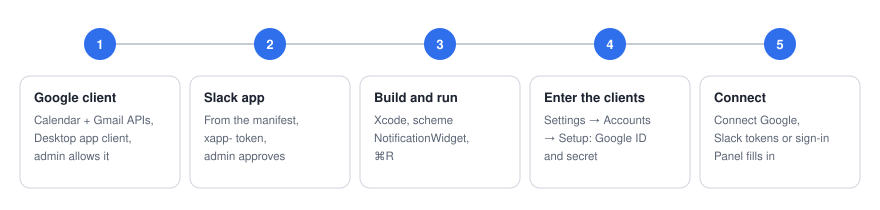
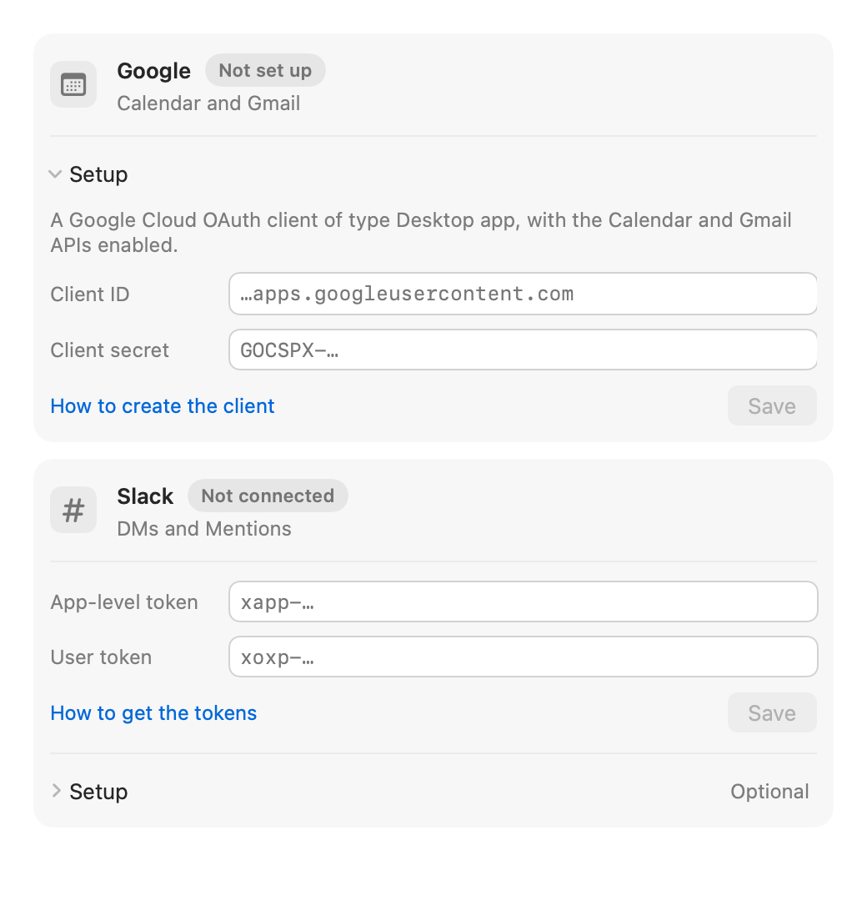

# Installation and setup

[← Back to the README](../../README.md)

Notification Widget isn't distributed as a download: you build it in Xcode with your own Google and Slack credentials. Plan for about an hour of your own time, plus however long your Workspace and Slack admins take to approve the two apps, so **start the approvals first**.



## What you need

- A Mac running the current macOS, with the current **Xcode** (from the App Store).
- Optional: an **Apple ID signed in to Xcode** (Xcode → Settings → Accounts). Signing with your team lets the app read macOS Focus status, so Alerts go quiet during a Focus. Without it everything else works.
- A **Google Workspace** account (the work account whose Calendar and Gmail you want), and someone who can approve apps in its Admin console.
- A **Slack** workspace, and someone who can approve apps in it.
- Optional: [XcodeGen](https://github.com/yonaskolb/XcodeGen) (`brew install xcodegen`), only if you change the project structure.

## Step 1: Google OAuth client

Create a Google Cloud OAuth client with the Calendar and Gmail read-only scopes, and get your Workspace admin to allow it.

→ Full steps: [Set up the Google OAuth client](../setup/google-oauth-client.md)

## Step 2: Slack app

Create the Slack app from the manifest in this repo, generate its app-level token, and get it approved and installed.

→ Full steps: [Set up the Slack app](../setup/slack-app.md)

## Step 3: Optional signing for Focus

You enter the Google and Slack clients in the app itself (step 5), so there's nothing secret to put in the repository. The only build setting you may want is your Apple team, so the app can read Focus status:

```sh
git clone https://github.com/adrianeyre/notification-widget.git
cd notification-widget
cp Config/Secrets.example.xcconfig Config/Secrets.xcconfig   # optional
open -e Config/Secrets.xcconfig
```

| Setting | Where it comes from |
|---|---|
| `DEVELOPMENT_TEAM` | Xcode → Settings → Accounts → your team's 10-character ID, or developer.apple.com → Membership |
| `CODE_SIGN_IDENTITY` | Leave as `Apple Development` |
| `CODE_SIGN_ENTITLEMENTS` | Leave as `App/NotificationWidget/NotificationWidget.entitlements` (the Focus status entitlement) |

`Config/Secrets.xcconfig` is git-ignored. Without it the app is signed to run locally and Alerts ignore Focus.

## Step 4: Build and run

1. Open `NotificationWidget.xcodeproj`.
2. Choose the **NotificationWidget** scheme and **My Mac**, then **Product → Run** (⌘R).
3. The app has no Dock icon. Look for its icon in the menu bar; the Panel appears at the top right of your main screen.

To keep using it day to day, build a Release copy and move it to Applications:

```sh
xcodebuild -project NotificationWidget.xcodeproj -scheme NotificationWidget -configuration Release \
  -derivedDataPath build/DerivedData build
cp -R "build/DerivedData/Build/Products/Release/Notification Widget.app" /Applications/
open "/Applications/Notification Widget.app"
```

## Step 5: Enter the clients and connect

Open **Settings…** from the menu bar icon and go to **Accounts**. Each Account is a card with its status, one button, and a **Setup** section.



**Google**

1. In **Google → Setup**, paste the **Client ID** and **Client secret** from step 1 and click **Save**. The status changes from *Not set up* to *Not connected*.
2. Click **Connect**, sign in with your work account in the browser and allow Calendar and Gmail access. The browser then shows whether it worked: *You're connected to Google*, or what went wrong and how to try again. Close the tab. The card shows your email address and *Connected*.

**Slack**

1. Optional: in **Slack → Setup**, paste the Slack app's **Client ID** and **Client secret** and click **Save**, to sign in through the browser instead of pasting a user token.
2. Paste the **app-level token** (`xapp-…`).
3. Click **Sign in with Slack…** and allow access (the browser confirms when it's done), or paste the **user token** (`xoxp-…`) and click **Save**. The card shows your name, workspace and *Connected*.

Client IDs are kept in the app's preferences; client secrets and tokens in your Keychain. The Panel fills in within a minute. Then:

- Allow **Focus** access when macOS asks (or later in Settings → Alerts), so Alerts go quiet during a Focus.
- If macOS asks to allow the login item, allow it in System Settings → General → Login Items, so the app starts at login.

## Putting the Panel on a strip display

Drag the Panel by its date onto the display you want. It remembers the screen and position. At 940 × 320 points it leaves room beside it on a 1920 × 360 display for other widgets, such as a clock on the left and other panels on the right.

Next: [Settings](configuration.md) · [Troubleshooting](troubleshooting.md)
