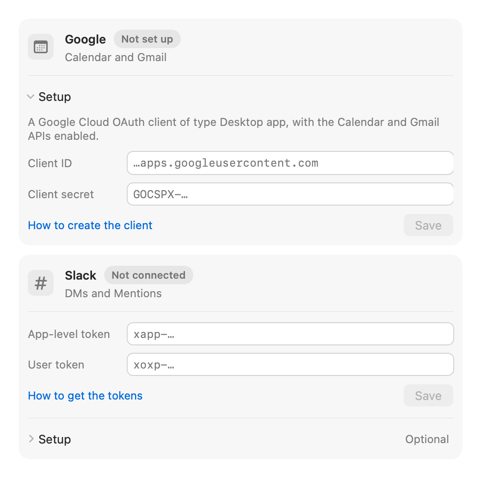

# Set up the Google OAuth client

[← Back to the README](../../README.md) · [Installation and setup](../guide/installation.md)

Issue #3. A manual task for the repo owner: it needs the Google Cloud console and a Google Workspace admin. Sign-in (SRC-1) and the Calendar and Gmail Sources depend on it. Start early, because admin approval can take a while (PRD §3).

## 1. Create the project and enable the APIs

1. In the [Google Cloud console](https://console.cloud.google.com/), create a project, for example `notification-widget`, under your Workspace organisation.
2. Go to **APIs & Services → Library** and enable:
   - **Google Calendar API**
   - **Gmail API**

## 2. Configure the consent screen

Go to **Google Auth Platform → Branding / Audience** (the older console calls this the **OAuth consent screen**).

- **Audience: Internal** if your Workspace admin allows it. Internal clients have no test-user list and their refresh tokens don't expire after 7 days.
- If Internal isn't allowed, choose **External**, leave it in **Testing**, and add your work address as the only **test user**. In testing mode Google expires refresh tokens after **7 days**, so you'll have to sign in again every week; the app shows "needs sign-in" when that happens (PRD §8).
- Under **Data Access**, add these scopes:
  - `https://www.googleapis.com/auth/calendar.readonly`
  - `https://www.googleapis.com/auth/gmail.readonly`

## 3. Create the OAuth client

Go to **Clients → Create client**:

- **Application type: Desktop app.** The app signs in through your browser and a redirect back to this Mac (`http://127.0.0.1` on a free port, with PKCE), which is what Desktop app clients are for. No redirect URI needs registering.
- **Name:** anything, for example `Notification Widget`.

After creating it, copy the **Client ID** (`…apps.googleusercontent.com`) and the **Client secret** (`GOCSPX-…`). Google treats a desktop client's secret as not confidential, but the app still keeps it in your Keychain.

## 4. Get the Workspace admin to allow the client

Ask your Workspace admin to allow the app in **Admin console → Security → Access and data control → API controls → Manage third-party app access**: add the app by its **client ID** and set it to **Trusted** (or at least allowed for the Calendar and Gmail scopes).

## 5. Enter the client in the app

In the app, open **Settings… → Accounts**. Under **Google → Setup**, paste the **Client ID** and **Client secret** and click **Save**. The ID is kept in the app's preferences and the secret in your Keychain; nothing goes in the repository and nothing needs rebuilding.

## Check it works

- Quick check: in the [OAuth 2.0 Playground](https://developers.google.com/oauthplayground/), authorise the two scopes with your work account. If the admin hasn't allowed the app, Google shows "access blocked".
- In the app: once the client is saved, Google's status changes from **Not set up** to **Not connected**. Click **Connect**. After the browser sign-in, your email address appears and Events and Emails start showing on the Panel.
