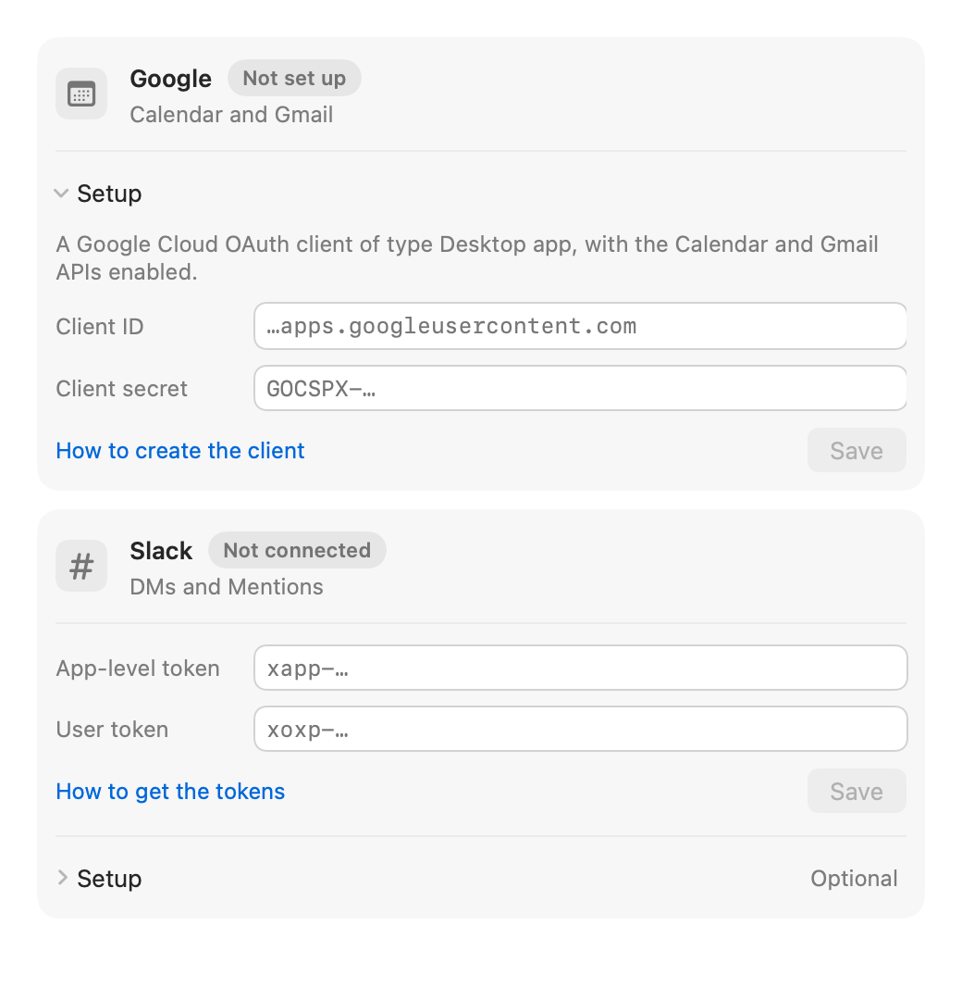

# Set up the Slack app

[← Back to the README](../../README.md) · [Installation and setup](../guide/installation.md)

Issue #4. A manual task for the repo owner: it needs the Slack app console and a Slack workspace admin. DMs and Mentions arrive over Socket Mode ([ADR 0002](../architectural-decision-record/0002-slack-socket-mode.md)). The app code for Slack comes in later issues; this gets the tokens and approval ready.

## 1. Create the app from the manifest

1. Go to <https://api.slack.com/apps> → **Create New App → From an app manifest**.
2. Choose the work workspace.
3. Paste [`slack-app-manifest.yml`](slack-app-manifest.yml) and create the app.

The manifest sets up everything the issue asks for:

| Setting | Value |
|---|---|
| Socket Mode | on |
| User token scopes | `im:history`, `mpim:history`, `channels:history`, `groups:history`, `im:read`, `mpim:read`, `channels:read`, `groups:read`, `users:read` |
| User events | `message.im`, `message.mpim`, `message.channels`, `message.groups` |
| Token rotation | off, so the user token doesn't expire |

## 2. Generate the app-level token

**Basic Information → App-Level Tokens → Generate Token and Scopes**: name it `socket`, add the `connections:write` scope, and generate it. This is the `xapp-…` token.

## 3. Get admin approval and install

**Install App → Install to Workspace** (or **Request to Install** if your workspace needs approval). Once the workspace admin approves it, install it for yourself. Slack shows a **User OAuth Token**: the `xoxp-…` token.

## 4. Optional: set up "Sign in with Slack"

Instead of copying the user token, the app can get it through Slack's sign-in page (SRC-8):

1. The manifest already adds the redirect URL `http://localhost:53682/slack/oauth/callback` (**OAuth & Permissions → Redirect URLs**). The app listens on that port, on this Mac only, while you sign in.
2. Copy the **Client ID** and **Client Secret** from **Basic Information → App Credentials** into the app: **Settings… → Accounts → Slack → Setup**, then **Save**. The ID is kept in preferences and the secret in your Keychain.
3. In Settings → Accounts → Slack, paste the app-level token and click **Sign in with Slack…**. Approve in the browser; the app picks up the user token and connects.

The app-level token is always pasted, because Slack doesn't issue it through OAuth. If Slack won't accept an `http://localhost` redirect URL for your workspace, paste the user token instead (step 5).

## 5. Paste the tokens into the app



Open Settings → Accounts → Slack, paste the `xoxp-…` user token and the `xapp-…` app-level token, and click **Save**. The app checks them with `auth.test` and `apps.connections.open`, shows your user and workspace, and keeps the tokens in the Keychain (SRC-1a). Don't commit them anywhere.

## Check it works

```sh
curl -s -H 'Authorization: Bearer xoxp-…' https://slack.com/api/auth.test
```

The response should include `"ok": true` and your user and team.
